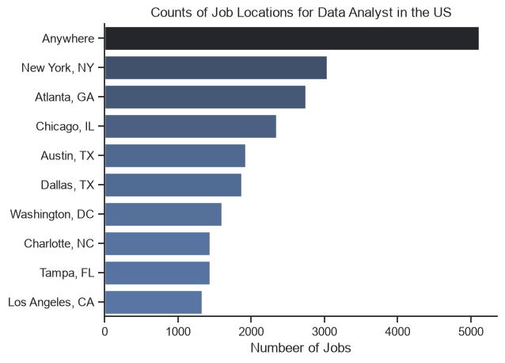
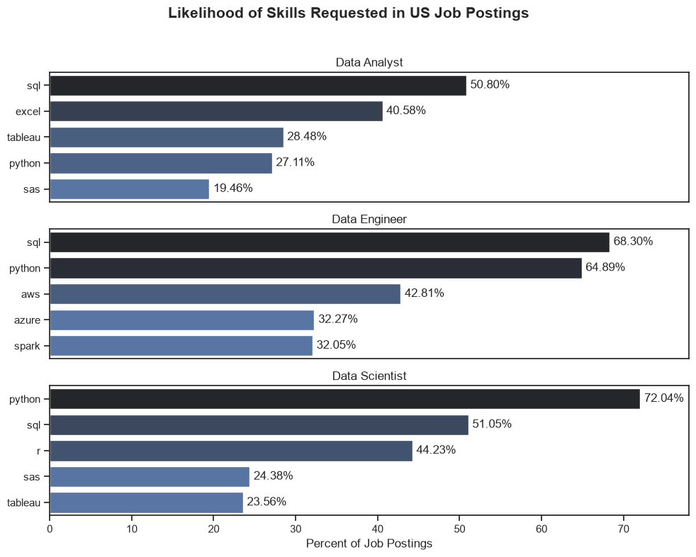
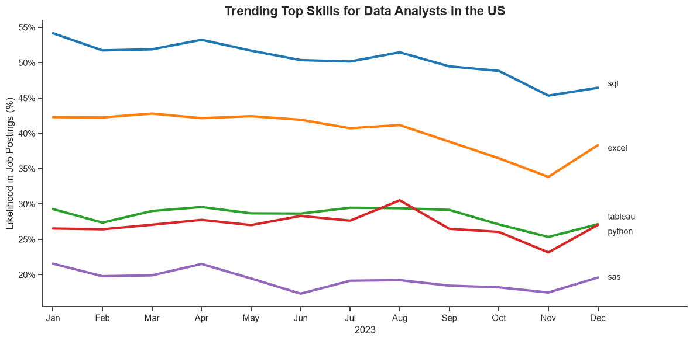
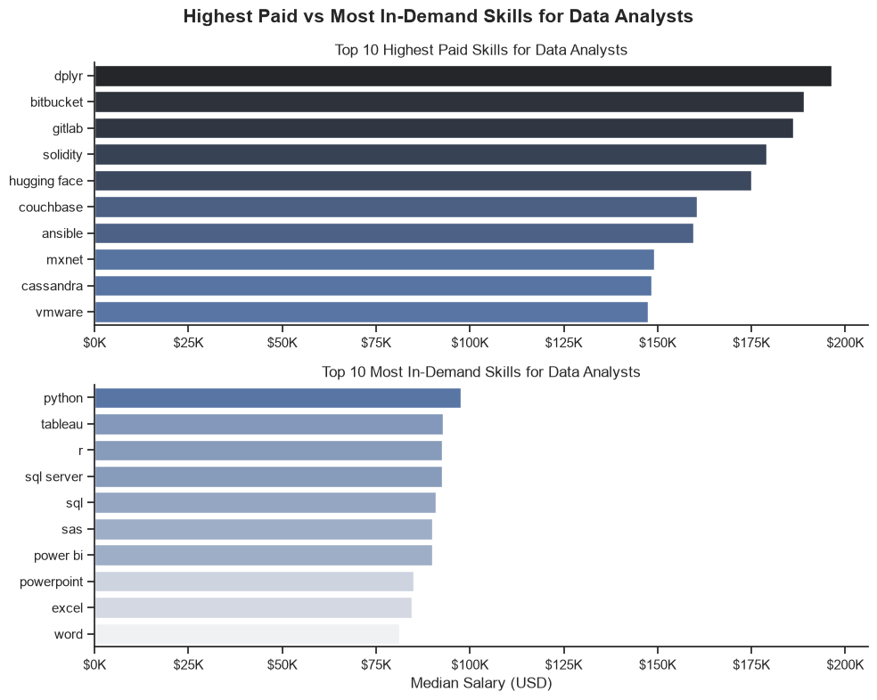
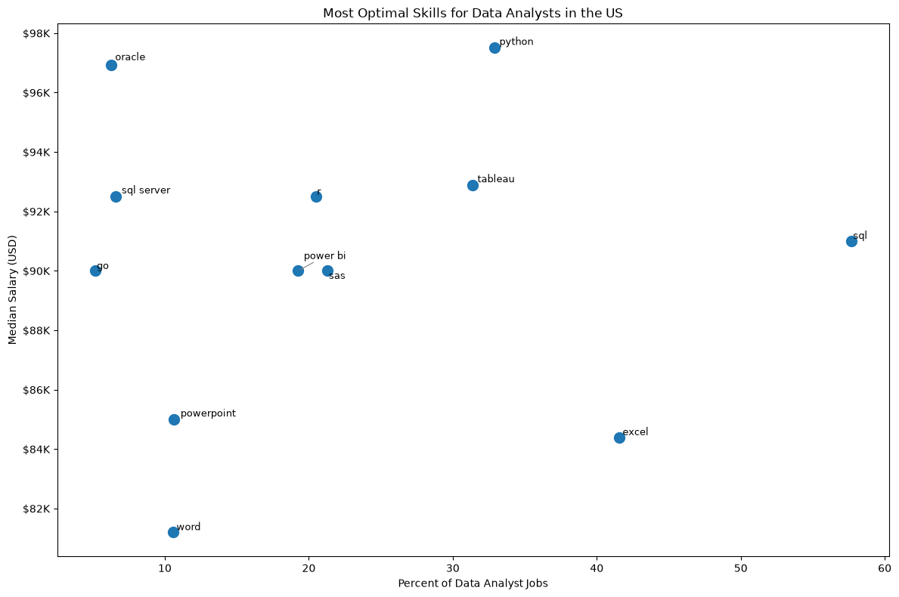

# Data Jobs Market Analysis

This project uses Python and Jupyter notebooks to explore job postings, the skills employers request, salary patterns, and skills that combine strong demand with higher pay. The analyses focus mainly on Data Analyst roles in the United States.

## Project notebooks

Run the notebooks in numeric order for a guided walkthrough. Each notebook loads and prepares the dataset independently, so it can also be run on its own.

1. **[1_EDA_Intro.ipynb](1_EDA_Intro.ipynb)** — Explore the dataset and examine US Data Analyst postings.
2. **[2_Skill_Demand.ipynb](2_Skill_Demand.ipynb)** — Find the most demanded skills for the three most popular data job titles, including skill counts and percentages.
3. **[3_Skills_Trend.ipynb](3_Skills_Trend.ipynb)** — Track monthly demand for Data Analyst skills in the US.
4. **[4_Salary_Analysis.ipynb](4_Salary_Analysis.ipynb)** — Compare salaries across popular data roles and analyze salary by skill for US Data Analysts.
5. **[5_Optimal_Skills.ipynb](5_Optimal_Skills.ipynb)** — Compare skill demand with median salary to identify potentially valuable skills for US Data Analysts.


## Notebook previews

The charts below are saved notebook outputs. Each preview includes a short methodology note and a finding from the saved results.

### 1. Exploratory data analysis

**Methodology:** Filter to US Data Analyst postings, count the most common locations, and inspect work-from-home, degree-mention, and health-insurance fields.

**Finding:** Anywhere is the most common location label, followed by New York, NY and Atlanta, GA.



### 2. Skill demand

**Methodology:** Filter US postings, expand the skill lists into rows, then compare skill counts and posting percentages for the Data Analyst, Data Engineer, and Data Scientist roles.

**Finding:** SQL leads Data Analyst and Data Engineer postings (50.8% and 68.3%); Python leads Data Scientist postings (72.0%).



### 3. Skills trend

**Methodology:** Filter to US Data Analyst postings, group skills by posting month, and normalize each skill count by that month's total postings.

**Finding:** SQL stays the most requested skill throughout 2023, with Excel second; both show month-to-month variation and a rebound in December.



### 4. Salary analysis

**Methodology:** Compare annual salary distributions for the six most frequent US job titles among postings with reported annual pay. For Data Analysts, expand the skill lists and calculate median salary and posting count per skill.

**Finding:** Among the ten most common Data Analyst skills in salary-reported postings, Python has the highest median ($97,500); SQL appears most often (2,508 postings).



### 5. Optimal skills

**Methodology:** For US Data Analyst postings with annual salary data, calculate each skill's share and median pay, then chart skills appearing in more than 5% of those postings.

**Finding:** SQL has the widest demand (57.7%); Python combines 32.9% demand with the highest median salary ($97,500) among skills above the 5% demand threshold.



## Data source

The notebooks load the `train` split of the [`lukebarousse/data_jobs` dataset on Hugging Face](https://huggingface.co/datasets/lukebarousse/data_jobs) using the `datasets` library. The dataset is converted to a pandas DataFrame in each notebook; posting dates are parsed as dates, and the skill lists are converted from text to Python lists.

You do not need to place a dataset file in this project folder. The dataset is fetched and cached by the Hugging Face `datasets` library. An internet connection is needed the first time it is downloaded.

## Requirements

The notebooks use Python 3.11 and the following packages:

- `datasets`
- `pandas`
- `matplotlib`
- `seaborn`
- `adjustText` (used in the optimal skills notebook)
- `jupyterlab`

## Setup and run

From this project folder, create and activate a virtual environment, install the packages, and start JupyterLab:

```bash
python -m venv .venv
```

On Windows PowerShell:

```powershell
.\.venv\Scripts\Activate.ps1
```

On macOS or Linux:

```bash
source .venv/bin/activate
```

Then install dependencies and start JupyterLab:

```bash
python -m pip install --upgrade pip
python -m pip install datasets pandas matplotlib seaborn adjustText jupyterlab
jupyter lab
```

In JupyterLab, open a notebook and choose **Run → Run All Cells**. Run cells from top to bottom so that each analysis has its required data and variables.

## Notes

- The salary analysis uses rows with a reported `salary_year_avg`; postings without that value are excluded from the salary comparisons.
- Most skill and salary conclusions are based on US job postings and the filters defined in the notebooks.
- The dataset may be updated, so counts, charts, and rankings can change when the notebooks are run again.
